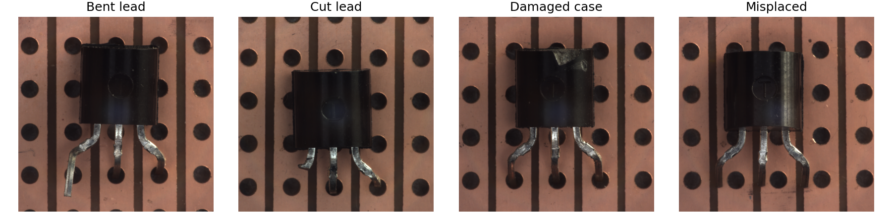
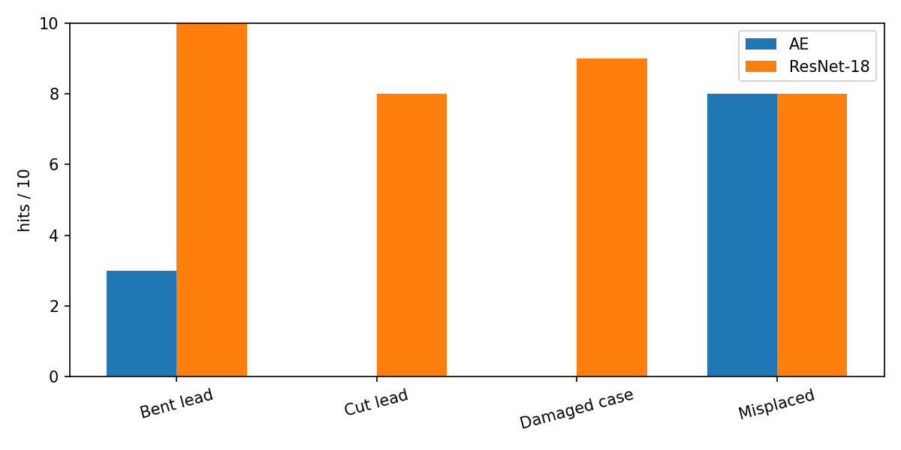

# Normal-only Defect Screening

MVTec AD의 transistor 사진만으로, 불량 예시 없이 정상과 불량을 가려 내는 개인 학습 프로젝트입니다. 출력은 클래스 이름이 아니라, 그 사진을 정상으로 통과시킬지 불량으로 걸러 낼지입니다. 펨트론 장비, 고객 기판, 반도체 웨이퍼와는 무관합니다.

학습에는 정상 170장만 씁니다. 문턱값은 정상 검증 43장의 95백분위수로 방법마다 미리 고정하고, 테스트 정상 60장과 불량 40장은 그 다음에 한 번만 봅니다. 테스트 점수가 더 좋은 층이나 문턱값은 고르지 않습니다.

## 두 가지 점수

같은 분할에서 두 점수를 비교합니다.

합성곱 오토인코더는 정상 사진만 복원하도록 학습하고, 입력과 복원의 픽셀 평균 제곱 오차를 이미지 점수로 씁니다. 고정 ResNet-18은 ImageNet 가중치를 갱신하지 않고, 16×16 특징 패치와 정상 패치 4,096개의 최근접 거리를 계산합니다. 이미지 점수는 그 패치 거리의 최댓값입니다. 점수 지도는 이 값이 커지는 위치를 보여 주는 그림이며, 결함 마스크를 학습한 분할 결과는 아닙니다.

두 번째 방법은 PatchCore처럼 여러 층을 합치거나 패치를 대표 집합으로 줄이지 않습니다. 위치마다 정상 분포를 맞추지도 않습니다. ResNet-18 한 단계와 최근접 거리만 있는 단순한 형태입니다.

## 이 저장소의 결과

시드는 42 한 번이고, 입력은 1024에서 256으로 줄였습니다. 학습과 추론은 로컬 CPU, Python 3.12.7, PyTorch 2.12.1+cpu입니다. 운영점에서 점수가 문턱값 이상이면 불량입니다.

| | 오토인코더 | ResNet-18 |
| --- | --- | --- |
| 문턱값 (검증 95%) | 0.002250 | 0.783784 |
| 오탐 / 정상 60장 | 2 | 1 |
| 미탐 / 불량 40장 | 29 | 5 |
| 이미지 단위 AUROC | 0.6733 | 0.9500 |
| 리드 휨 | 3/10 | 10/10 |
| 리드 절단 | 0/10 | 8/10 |
| 케이스 손상 | 0/10 | 9/10 |
| 위치 어긋남 | 8/10 | 8/10 |

오토인코더는 정상 오탐은 적지만 불량 40장 중 29장을 넘깁니다. 위치 어긋남은 10장 중 8장을 걸러 냈고, 리드 절단과 케이스 손상은 한 장도 걸러 내지 못했습니다. ResNet-18은 같은 규칙에서 미탐이 5장입니다. AUROC는 순서를 얼마나 잘 나누는지만 보여 주며, 운영점을 대체하지 않습니다.

밝기 0.7배와 1.3배는 다시 학습하지 않고 문턱값도 유지한 채 판정이 바뀐 장수만 세었습니다. 오토인코더는 정상 60장 중 56장과 58장, 불량 40장 중 28장과 29장이 바뀌었습니다. ResNet-18은 배율 0.7에서 정상 1장과 불량 1장, 배율 1.3에서 정상 1장과 불량 2장입니다.

숫자 전체는 `outputs/summary.md`에 있습니다. 네 유형 예시와 맞힌 장수, 혼동행렬, 문턱값 곡선, 점수 지도는 `outputs/figures/`에 있습니다. 데이터 사진이 들어간 그림은 MVTec AD, Bergmann et al., CC BY-NC-SA 4.0입니다.





## 데이터

이미지는 이 저장소에 없습니다. [MVTec AD](https://www.mvtec.com/research-teaching/datasets/mvtec-ad)에서 transistor 범주를 받아, 저장소 밖에 두고 경로만 지정합니다. 라이선스는 CC BY-NC-SA 4.0이며 상업적 사용은 허용되지 않습니다.

```powershell
$env:TRANSISTOR_DATA_ROOT = "D:\data\mvtec_ad\transistor"
```

필요한 구성은 `train/good` 213장, `test/good` 60장, `test/bent_lead`, `test/cut_lead`, `test/damaged_case`, `test/misplaced` 각 10장, `ground_truth/<유형>` 각 10장입니다. 장수가 다르면 스크립트는 학습을 시작하지 않습니다.

## 다시 실행

```powershell
pip install -r requirements.txt
python data.py --write-split --examples
python train_autoencoder.py
python score_embedding.py
python evaluate.py
python score_brightness.py
python evaluate.py --timing --finalize
```

`outputs/`에 이미 가중치, 패치 은행, 점수, 그림이 들어 있습니다. 오토인코더만 GPU에서 다시 학습하려면 정상 213장과 `outputs/split.json`만 올리고 `python train_autoencoder.py --train-only`를 실행한 뒤, `autoencoder.pt`와 `ae_loss.csv`를 받아 로컬에서 `python train_autoencoder.py --scores-only`를 실행합니다. 테스트 사진과 정답 마스크는 그 학습 환경에 올리지 않습니다.
